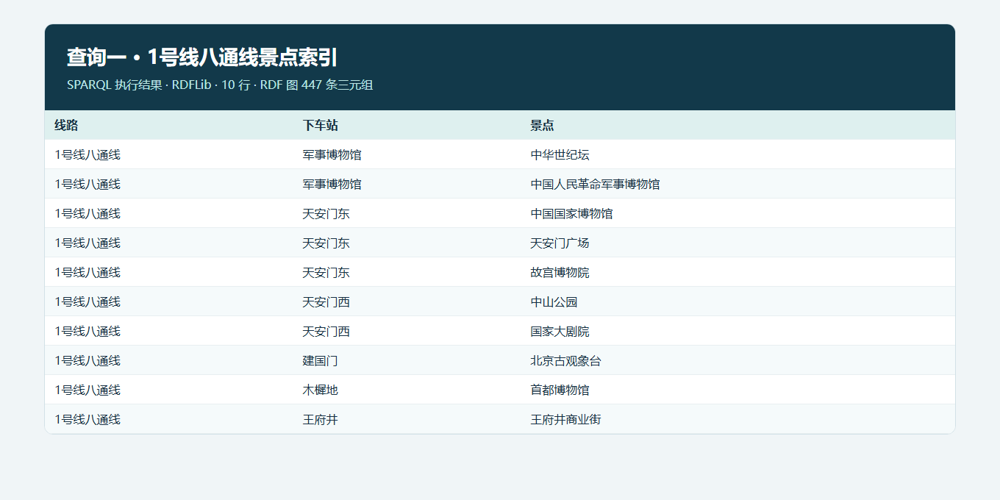
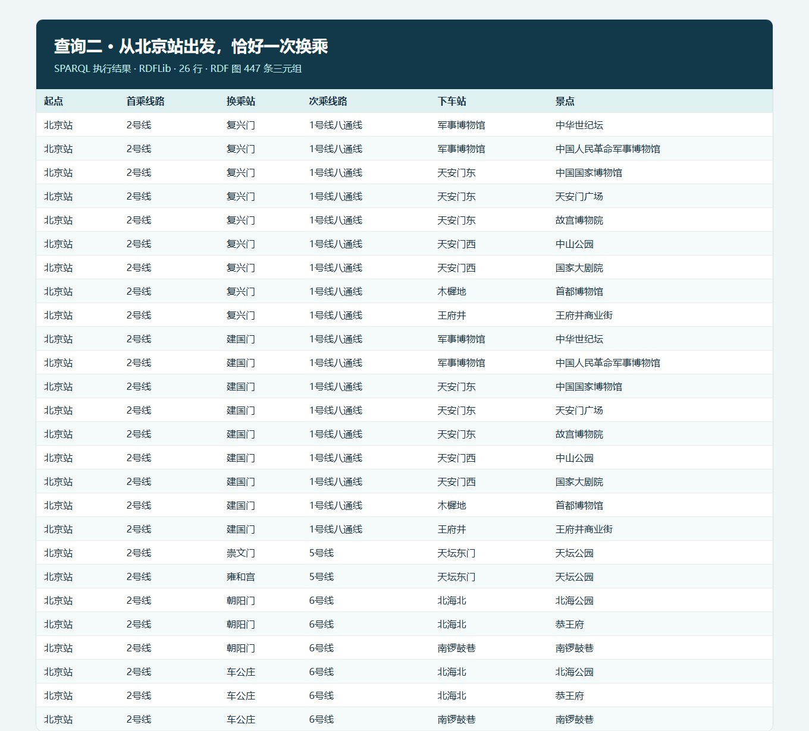

# 应用文档｜北京地铁换乘与景点导览

## 业务场景

住在北京站附近的游客，希望先按线路浏览景点，再了解从北京站出发需要换乘一次的备选行程。导览查询输出下车站，换乘结果同时给出首乘线路、换乘站和次乘线路。

## 查询一：按线路浏览景点

参数 `VALUES ?line` 选定 1号线八通线。查询沿「线路 ← 所属线路 ← 车站 ← 下车站 ← 景点」连接线路、站点和景点。如需查询样本中的其他线路，将 IRI 改为 `id:line-2`、`id:line-5` 或 `id:line-6`。

[SPARQL 代码](queries/01-line-attractions.rq) · [完整结果 CSV](results/01-line-attractions.csv)

```sparql
PREFIX kg: <https://w3id.org/beijing-metro-course/schema/>
PREFIX id: <https://w3id.org/beijing-metro-course/id/>
PREFIX rdfs: <http://www.w3.org/2000/01/rdf-schema#>

SELECT DISTINCT ?lineName ?stationName ?attractionName WHERE {
  VALUES ?line { id:line-1 }
  ?line rdfs:label ?lineName .
  ?station kg:onLine ?line ; rdfs:label ?stationName .
  ?attraction kg:servedBy ?station ; rdfs:label ?attractionName .
}
ORDER BY ?stationName ?attractionName
```

结果为 **10 行**。例如，可在天安门东下车前往故宫博物院、中国国家博物馆或天安门广场。



## 查询二：从北京站出发，恰好换乘一次

参数 `VALUES ?startName` 使用带中文语言标签的站名。核心查询沿「起点 → 首乘线路 ← 换乘站 → 次乘线路 ← 到达站 ← 景点」匹配五条关系。起点、换乘站和下车站必须满足两段均有乘车的约束，两条线路必须不同。每条线路样本为连通的连续站段，因此同线的两站可在样本内互达。查询使用反存在条件剔除在样本内已有直达方案的景点。

[SPARQL 代码](queries/02-one-transfer.rq) · [完整结果 CSV](results/02-one-transfer.csv)

```sparql
PREFIX kg: <https://w3id.org/beijing-metro-course/schema/>
PREFIX rdfs: <http://www.w3.org/2000/01/rdf-schema#>

SELECT DISTINCT ?startName ?firstLine ?transferName ?secondLine
                ?arrivalName ?attractionName WHERE {
  VALUES ?startName { "北京站"@zh }
  ?start a kg:Station ; rdfs:label ?startName ; kg:onLine ?first .
  ?transfer kg:onLine ?first, ?second ; rdfs:label ?transferName .
  ?arrival kg:onLine ?second ; rdfs:label ?arrivalName .
  ?attraction kg:servedBy ?arrival ; rdfs:label ?attractionName .
  ?first rdfs:label ?firstLine .
  ?second rdfs:label ?secondLine .
  FILTER (?first != ?second && ?start != ?transfer && ?transfer != ?arrival)
  FILTER NOT EXISTS {
    ?start kg:onLine ?direct .
    ?attraction kg:servedBy/kg:onLine ?direct .
  }
}
ORDER BY ?secondLine ?transferName ?arrivalName ?attractionName
```

结果为 **26 个换乘方案，涉及 13 个不同景点**。可在崇文门由 2号线转 5号线，在天坛东门下车前往天坛公园。也可在朝阳门转 6号线，前往南锣鼓巷。天坛公园在样本中另有经雍和宫换乘的方案，所以一处景点可以占多行。前门大街、雍和宫和北京古观象台在样本内可直接乘 2号线到达，故从换乘结果中排除。



## 使用边界

结果表示四条线路样本内的拓扑可达性。方案按线路及站名排序，未引入列车时刻、乘车耗时、出口步行距离及临时运营调整。实际出行请以当日运营和景区公告为准。
